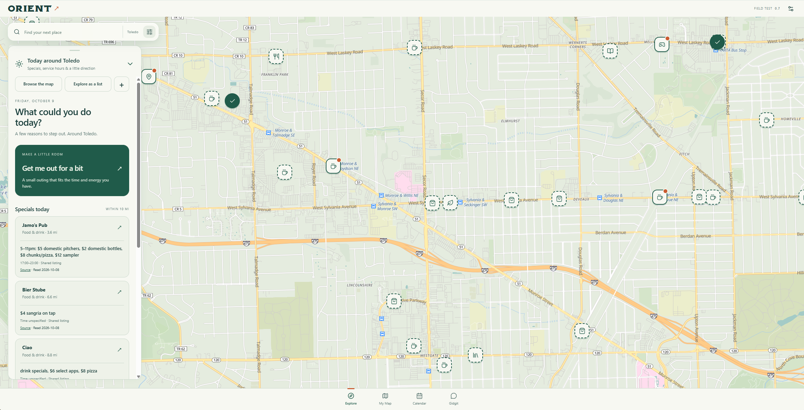

# Orient

**A map for getting to know your city. Yours to fill in, and yours to share if you'd like.**



Orient began in Toledo, Ohio, with a small question: *what would make me leave the house and explore?*

A comic shop I keep meaning to visit. Coffee before the thrift store. A quiet bench by the river. Somewhere I can walk into alone and feel comfortable. The useful parts of a city usually come from trying a place, talking to someone, and remembering one small thing about it.

Orient is a place to keep those things: a private map that gets more familiar the more you use it. And if you want to, you can leave a small note that makes it easier for a stranger to go somewhere new.

You don't have to live in Toledo, and you don't have to write code. If you're curious about your own city, you're who this is for.

## Come and try it

You need Node.js 18 or later. There's nothing to install and no build step.

```sh
git clone https://github.com/ragingapathy/orient.git
cd orient
node server.cjs
```

Open [localhost:4173](http://127.0.0.1:4173), pick your city, and add one place you know or want to try. That's the whole start. Everything else shows up as you go.

Prefer a phone? Orient installs like an app (Share → Add to Home Screen, or your browser's install button) and keeps working without a connection. Docker, pairing a phone, backups and the rest of the setup are in the [user guide](docs/user-guide.md).

## What it's like

- **A little direction, not a lecture.** Open Explore and get a short briefing: today's weather, specials, what's open nearby, and places you saved but haven't tried yet. Ask for "a little outing" when you want a nudge, or keep the map in view when you don't.
- **A map that remembers.** Save places, tap a check each time you go, add a photo and a note, rate them, sort them into collections, plan a small circuit for Sunday. The fog lifts as you explore. Pick your own icon for any place.
- **Your city, right now.** Weather, road closures and construction, traffic cameras and incidents, so you know what's in the way before you head out.
- **It orients.** Open the app, or tap the compass, and the map finds you and turns north-up. It looks once each time you ask and never follows you, and where you are is never saved or sent anywhere.
- **Where your money goes.** Write down what you spend, mark places as local or a chain, and see how much of it stays in your community. It's a private number, and only you see it.
- **Places that tell you things.** Orient can read the information a business publishes about itself (hours, address, links) and hold it up for you to check before it goes on your map.
- **Take it somewhere else.** Tap the city beside search to explore a neighboring town. Home stays home.
- **Ask Gidgit, if you like.** An optional AI companion that answers questions about your saved map, running on your own computer by default. It stays hidden unless you turn it on.

There's no account. Your map lives in your browser, and can sync privately to the computer running Orient so your phone and laptop agree.

## Your map stays yours

Everything above is private by default: places, notes, photos, visits, spending, the people you remember. Nothing leaves your device unless you export it or choose to share a note. Your location is only read when you open the app or tap the compass, and it stays in memory. The neighbor guide never goes anywhere at all.

## A shared layer, if you want one

A map can tell you where something is. A small observation can make it easier to go:

> “You can browse without buying.”
>
> “There’s seating where you can stay a while.”
>
> “This stretch of the river is quiet.”

Orient has a **place commons** for notes like these. Choose **Share this note** on a place, trim it to the part you want to give, and tick the consent box. Orient shows you exactly what will be shared, in plain words, then opens GitHub's own new-file page with it filled in. You sign in as yourself, and nothing is posted until you press the button.

Someone else can load a commons, read the claims one by one, and decide which belong on their map. Nearby coordinates suggest matches, and they choose whether to link an existing place or add a new one. Shared notes stay tucked in a fold, labeled with who said them and when, so a note from last year doesn't pose as today's truth.

Anyone can start a commons for their own city. [`commons-template/`](commons-template/README.md) is a repository you copy, with a check on every contribution and a snapshot that rebuilds when you merge one. The first is [Toledo commons](https://github.com/ragingapathy/toledo-commons). Two people can run commons for the same city, and a third can combine them; each keeps its own name on its own notes.

People fields, visit histories, saved lists, photos, circuits, spending and calendar data are never part of a public bundle. **Want to see how it works?** Read the [commons guide](commons/README.md), open the [fictional example bundle](commons/examples/toledo.snapshot.json), or look at the [public schema](commons/schema/).

## Come build it with us

This is a small, honest prototype with plenty of room for other people's ideas. There's no experience required and no wrong way to start.

- **Just use it.** Take Orient on a real outing and tell us what happened: where it helped you leave the house, where it got in the way, what you wished it knew. That's the most useful thing anyone can give us.
- **Start a commons for your city.** A few good observations, carefully kept, is a fine beginning. Review someone else's if you'd rather start there.
- **Make it kinder to use.** Clearer words, better small-screen layouts, accessibility, a nicer first minute. If something confused you, it confuses others.
- **Bring your own sense of what makes a place welcoming.** It's different for different people, and we'd like to ask better questions about it.
- **Build something.** Better commons review, an easier path to GitHub, more reliable hours parsing, smarter ways to turn a saved place into an actual outing. Or something we haven't thought of.

[Open an issue](https://github.com/ragingapathy/orient/issues) with an idea, a bug, or something you noticed. If you'd like to change something, fork the repo and open a pull request that says what it helps someone do. For a bigger change, start with an issue so we can shape it together. Please use made-up places and notes in examples, and keep personal exports and local catalogs out of commits.

The app is plain JavaScript and CSS in `public/`, with a small Node server in `server.cjs`. No framework or build pipeline stands between you and an experiment. `npm test` runs every check against a test server of its own (your map is never touched; `node run-checks.cjs spend icons` runs just some), and `npm run check` is the quick syntax pass. The checks use Playwright and Chrome; the [user guide](docs/user-guide.md#checks) has the details.

## Where things stand

The private map and the reviewed commons loop both work today. It's early: interfaces change, and setup is still aimed at people comfortable running a small server. A commons source name is attribution, not proof of who wrote something, and observations age, so dates, sources and retired notes stay visible.

Publishing to GitHub works after a one-time connection in Orient. This self-hosted version stores an access token, encrypted, on the computer running Orient; signing in with GitHub directly, without a token, is still to come. There's no hosted multi-user service.

## License and credits

Orient's code is under the [PolyForm Noncommercial 1.0.0](LICENSE) license. Notes shared to a place commons are **CC BY 4.0**, as each public bundle says. They are separate licenses, and sharing a note doesn't make your private map public.

Map data © [OpenStreetMap](https://www.openstreetmap.org/copyright) contributors; basemap by [OpenFreeMap](https://openfreemap.org/). Vendored libraries and fonts keep their own licenses; see the [user guide](docs/user-guide.md#credits-and-license) and `public/vendor/`.

**Start with one place. Make it easier for someone to go. Build from there.**
